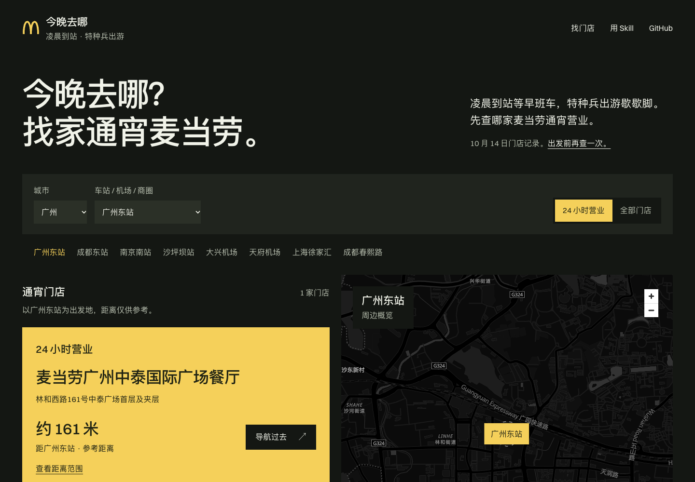

# 今晚去哪 · mcd-overnight

> Find a 24-hour McDonald's near train stations, airports and city centers in China when you arrive late at night. A Skill built on the official McDonald's China MCP.

**凌晨到站、特种兵出游，先找家通宵麦当劳。**

- **凌晨到站**：火车晚点、凌晨落地，想找个地方等第一班地铁或早班车。
- **特种兵出游**：一天跑几个景点，夜游结束或行程衔接时，想找家麦当劳吃点东西、歇歇脚。

出发前都得先弄清楚：附近哪家麦当劳通宵营业，离我说的地方多远，怎么过去？

「今晚去哪」是一个基于**麦当劳中国官方 MCP** 的找店 **Skill**。告诉它你在哪、几点到、想等到几点，帮你查营业时间、找附近门店，再按地址导航过去。

[体验网页 Demo](https://fabian4.site/mcd-overnight/) · [查看 Skill](./skills/mcd-overnight/SKILL.md) · [安装使用](#安装使用) · [参赛 Issue #747](https://github.com/M-China/mcd-developer-innovation-challenge/issues/747)



## 出发前，再问一句

> 凌晨两点到广州东站，想找家麦当劳等到早上六点。哪家通宵营业？给我地址和导航。

特种兵出游，也可以这样问：

> 特种兵周末游上海，晚上十一点在外滩，想找家营业到凌晨的麦当劳吃点东西、歇一会儿。附近哪家合适？给我完整营业时间和导航。

Skill 会查询附近门店，优先推荐营业时段能覆盖所需时间的选择，并给出：

- **完整营业时间**：24h 店写「24 小时营业」；其他店写 `07:00–23:00` 或 `09:00–次日 02:00`。
- **距离与参照地点**：说明距离是相对哪座车站、机场或搜索地点。
- **店名、地址和导航**：按真实地址打开地图，提醒安检内等通行限制。

没找到合适门店、门店暂停营业或查询失败时，会说清原因，不把同城远处的店当作附近推荐。

## 先试试，再决定怎么用

| | 找店 Skill | 网页 Demo |
|---|---|---|
| 适合做什么 | 按你的地点和时间查询、判断营业时段 | 体验选地点、看门店、打开导航的过程 |
| 信息来源 | 麦当劳 MCP 实时查询，必要时参考旧记录 | 2026-10-14 的真实门店记录 |
| 是否需要配置 | 需要支持 MCP 和 Skills 的客户端及自有 Token | 打开即用，不需要 Token |

网页只展示有可用通宵门店记录的城市和地点。可以从广州东站、成都东站、南京南站、沙坪坝站、大兴机场、天府机场、上海徐家汇、成都春熙路这 8 个例子开始，查看完整营业时段、打开导航，或复制提问交给 Skill 再查一次。

<details>
<summary>查看手机版截图</summary>


</details>

## 安装使用

1. 在[麦当劳 MCP 平台](https://open.mcd.cn/mcp)申请 Token，保存在本机环境变量 `MCD_MCP_TOKEN` 中。
2. 参考 [`mcp-config.example.json`](./mcp-config.example.json)，在客户端连接 `https://mcp.mcd.cn`，使用 Streamable HTTP 和 Bearer 认证。环境变量引用方式以客户端支持为准。
3. 将 [`skills/mcd-overnight`](./skills/mcd-overnight/) 安装到客户端的 Skills 目录，并启用麦当劳 MCP。
4. 发出上面的提问，或告诉它你的城市、出发地、到达时间和离开时间。

Token 留在本机，不填写到网页，也不要发到聊天或提交仓库。接入参数、工具与调用流程见 [MCP_INTEGRATION.md](./MCP_INTEGRATION.md)。

需要离线参考时，保留完整仓库并让客户端能访问根目录的 `data/`。只安装 Skill 文件夹不会附带这些数据；使用旧记录时，Skill 会标明日期。

## 关于门店信息

底层数据包含 **13 城、697 家**去重门店记录，采集于 **2026 年 10 月 14 日**，原始城市榜覆盖其中 12 城；网页仅选择有可用通宵地点记录的城市做演示。单次查询最多返回约 5 家，因此这是一份抽样记录，不能当作全城门店名录；没记录到通宵店，不代表附近一定没有。

距离相对当次搜索地点，不是用户当前位置距离或步行路线。地图圆环只表示距离范围，不代表门店方向；导航按完整店名和地址搜索。

**24 小时营业不等于可以留宿，是否开放堂食、能否停留以门店现场为准。** 请安静消费、不占多座。项目不承诺座位、插座或可留宿，也不推断价格、优惠和客流。

## 本地运行

网页为纯静态页面，无需麦当劳 Token 或后端服务：

```bash
python3 -m http.server 8787 --bind 127.0.0.1
```

打开 `http://127.0.0.1:8787`。部署到 GitHub Pages 时，直接使用仓库根目录即可。

验证门店筛选、营业时段展示和导航链接：

```bash
node --test tests/store-model.test.mjs
```

源码分为 `skills/`（找店 Skill）、`index.html` / `page.css` / `page.js`（网页）、`store-model.mjs` / `tests/`（门店逻辑与测试）、`data/`（门店记录和城市榜）。`scripts/refresh_stores.py` 提供限速、只读的定点查询辅助，不会自动重建全部网页数据。

## 参赛说明

本项目为[麦当劳程序员创意开发大赛](https://github.com/M-China/mcd-developer-innovation-challenge)开发，参赛主体是找店 Skill。由参赛者独立开发，**非麦当劳官方产品**。

[参赛声明](./CONTEST_DECLARATION.md) · [MCP 集成说明](./MCP_INTEGRATION.md) · [脱敏配置示例](./mcp-config.example.json) · [MIT 许可证](./LICENSE)

如果这个小工具对你有帮助，欢迎点个 Star，也欢迎反馈真实使用中遇到的问题。
